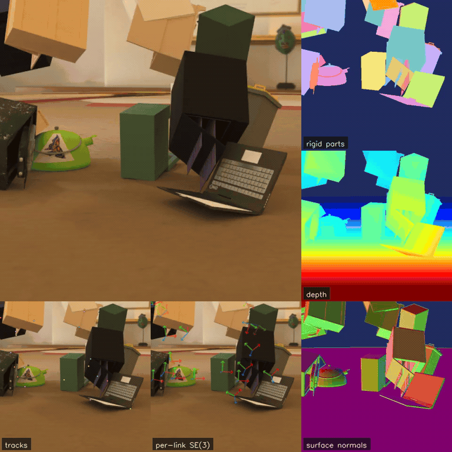

# Art-Kubric

A data generation pipeline for synthetic videos of articulated and rigid objects,
with dense 2D/3D point tracks, per-link SE(3) poses, and rigid-part segmentation.

[Paper](https://arxiv.org/abs/2610.03716) · [Project](https://mose3-tracker.github.io/) · [Dataset](https://huggingface.co/datasets/mose3-tracker/Art-Kubric)

[](https://mose3-tracker.github.io/assets/artkubric/0001.mp4)

Scene 0001: RGB, point tracks, link poses, rigid-part segmentation, depth, and surface normals.

## Motivation and design

Articulated objects can move differently at each joint. Art-Kubric records motion
at the link level, providing ground truth for point tracking and rigid-motion
estimation. Scenes are simulated in SAPIEN with physical interactions, moving
cameras, and varied lighting.

The released dataset contains 5,000 scenes, each with 120 frames at 512×512
resolution and 32,768 point tracks.

## Installation

Python 3.10. Rendering requires an NVIDIA GPU with Vulkan support.

```bash
pip install -r requirements.txt
```

## Assets

```bash
export SAPIEN_ASSETS_ROOT=/path/to/assets
export SAPIEN_TOKEN=...  # obtain from https://sapien.ucsd.edu
python download_partnet.py
python tools/fetch_infinigen.py
bash tools/compile_articraft_batch.sh
python preprocess_assets.py --config assets_config.yaml
```

`excluded_assets.json` excludes 27 PartNet-Mobility instances used in iTACO evaluation.

## Generation

Generate one scene with the dataset settings:

```bash
python generate.py --num-scenes 1 --start-idx 1 --data-dir output \
  --assets-index "$SAPIEN_ASSETS_ROOT/assets_index.json" \
  --output-format cotracker --continue-on-error \
  --num-frames 120 --fps 60 --width 512 --height 512 --tracks 32768 --bg-frac 0.07 \
  --scene-mix-mode varied --source-mix-mode index \
  --camera-mode linear_movement_linear_lookat --dynamic-rigid-motion \
  --rich-lighting --env-light-scale 0.25 --light-level-min 0.0 --light-level-max 0.9 \
  --fov-min 18 --fov-max 90 --fov-framing-alpha random \
  --camera-inner-radius 4 --camera-outer-radius 7 \
  --spawn-min-gap random:0.5:1.0 --spawn-xy-scale random:0.65:1.0
```

Outputs are written to `output/0001/`. Use `--resume` to continue an interrupted run.
The rendering seed is the scene index, or `--seed-override`. Tracking uses the
recorded scene seed and saves `tracking_seed`; `sample_tracks.py --seed` overrides it.
`--output-format full` also exports normals, object coordinates and object segmentation.
See the [dataset card](https://huggingface.co/datasets/mose3-tracker/Art-Kubric) for file and coordinate definitions.

## Citation

```bibtex
@inproceedings{cheng2026mose3,
  title     = {MoSE3: Learning World-Space SE(3) at Every Pixel},
  author    = {Cheng, Joanna Jiahuan and Li, Zhiyi and Xia, Tian and
               Cai, Ruojin and Du, Yilun and Wang, Qianqian},
  booktitle = {Advances in Neural Information Processing Systems (NeurIPS)},
  year      = {2026}
}
```

## License and acknowledgements

Code: MIT. Dataset annotations: CC-BY-4.0. Assets retain their original licenses.

Built with [SAPIEN](https://sapien.ucsd.edu/) and assets from
[PartNet-Mobility](https://sapien.ucsd.edu/),
[Infinigen-Articulated](https://huggingface.co/datasets/princeton-vl/infinigen-articulated),
[Articraft](https://github.com/mattzh72/articraft),
[Google Scanned Objects](https://arxiv.org/abs/2204.11918)
and [Poly Haven](https://polyhaven.com/hdris).
